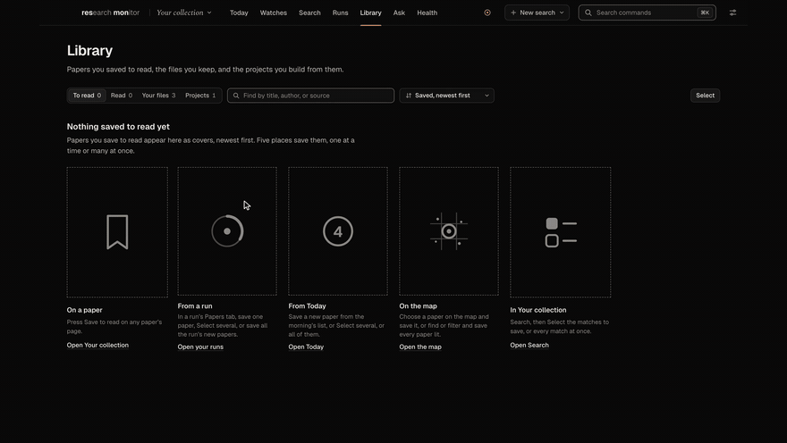

<p align="center">
  
</p>

<h1 align="center">resmon</h1>

<p align="center">
  <strong>New papers, charted. Every source, accounted for.</strong>
</p>

<p align="center">
  <a href="https://github.com/ryanjosephkamp/resmon/actions/workflows/ci.yml"></a>
  
  
</p>

<p align="center">
  <a href="https://ryanjosephkamp.github.io/resmon/">Site</a> ·
  <a href="https://ryanjosephkamp.github.io/resmon/#tour">The 54-second tour</a> ·
  <a href="https://ryanjosephkamp.github.io/resmon/guide/">Guide</a> ·
  <a href="https://github.com/ryanjosephkamp/resmon/releases">Download</a>
</p>



resmon searches arXiv, PubMed, OpenAlex, Crossref, bioRxiv, and 21 more open scholarly sources, on
demand or on a schedule. It de-duplicates what they return, keeps every paper in a database on your
computer, writes a report for every run, and records what every source did on every run, so a quiet
week and a broken search never look the same.

It never claims more than it knows. A field extracted from a document, a field matched against your
collection, and a field guessed by a model are different kinds of fact, and resmon labels which is
which. Where it cannot know something, it says so instead of showing a plausible number.

## What it does

- **Today:** your whole collection drawn as a map, with the papers collected since you last marked
  them read ringed and numbered, and the list beside it grouped by watch.
- **Deep Dive and Deep Sweep:** one source in depth, or several at once. Before you ask, resmon says
  what each source will do with your search: how it combines your terms, whether it can honor your
  dates, and whether it needs a key.
- **Watches:** the same search on a schedule, or a person's new papers, or retractions and
  corrections on a person's papers. A watch runs only in the background service, and resmon says so
  wherever it matters. Each run can ask for the papers published since the previous run, with the dates
  computed when it runs and recorded with the run.
- **Health:** the **Source wall** shows what each source did on each of the last runs, with a
  failure, an empty answer, and an outcome resmon did not record all drawn differently. The
  **Watchdog** reports sources that fail repeatedly, watches that are overdue, and departures from
  your own history, and says what it cannot judge yet.
- **Search:** your whole collection by words or by meaning, filtered by source, category, author, and
  date, with reference export as BibTeX, RIS, or CSV. A coverage audit compares a watch's results
  with what you meant it to find, and a shared-wording scan finds abstracts that repeat each other word
  for word.
- **People:** follow a researcher. Every match to a person says how it was made: by ORCID, by name and
  affiliation, or by name alone, and only the first is evidence of identity.
- **Library and Evidence:** a reading queue; copies of PDF, TXT, and MD files in a folder you choose;
  and projects where you pin exact passages and ask questions of excerpts you pick, with citations
  checked against the text. The Library is unavailable on Windows.
- **Ask, summaries, and an MCP server:** an assistant that answers from resmon through the same tools
  an outside program can use, and waits for your approval before changing anything. Summaries and Ask
  run on a signed-in Claude Code or Codex command, or on your own provider key. Nothing is billed
  through resmon.
- **Delivery, backup, and the command line:** reports by email, to a folder, to an Atom feed, or to a
  signed webhook, with a record of whether each arrived; backups to a folder, such as Google Drive for
  desktop's; and a `resmon` command for a terminal.

There is no account, no resmon server, and no telemetry. The collection is a SQLite database on your
disk, and keys are kept in your operating system's keychain.

## Install

Download a build from [Releases](https://github.com/ryanjosephkamp/resmon/releases).

| Platform | File | Status |
|---|---|---|
| macOS, Apple Silicon | DMG | Tested: installed and used daily |
| macOS, Intel | DMG | Built and launched once by the release workflow's check; not used daily |
| Windows (x64) | Installer (`.exe`) | Built and launched once by the release workflow's check; not used daily |
| Linux (x64) | AppImage | Built and launched once by the release workflow's check; not used daily |

The macOS builds are unsigned, so the first launch needs one extra step. Windows and Linux builds
update themselves, and macOS builds do not. The Library is unavailable on Windows. All of this is
covered in [Install and launch](https://ryanjosephkamp.github.io/resmon/guide/install/), along with
running from source:

```bash
git clone https://github.com/ryanjosephkamp/resmon.git
cd resmon
python3 -m venv .venv && source .venv/bin/activate
pip install -r requirements.txt
cd resmon_scripts/frontend && npm install && npm start
```

A resmon window does not run your watches. The background service does: turn on **Settings › In the
background › Run resmon in the background**. On macOS and Windows the service is the app itself, and
on Linux it is the engine.

## Command line

`resmon` asks the running resmon (the background service, or the app's own engine) what it has
collected and how its watches are doing, in the app's words, with `--json` on every command. It never
opens the database and never starts resmon itself; with nothing running, it says where it looked and
exits with status 3. It ships inside the app: choose **Install "resmon" Command in PATH** (in the
resmon menu on macOS, in the Help menu on Windows and Linux). From a clone, install it with
[pipx](https://pipx.pypa.io/); it needs Python 3.10 and nothing else.

```bash
pipx install ./resmon_scripts/cli
resmon today            # papers first collected since you last marked all read, by watch
resmon wall             # every source's answer to each recent run
resmon service status   # which resmon it reached, and whether your watches will run
```

The other commands are `search`, `runs`, `export`, and `watch list` / `watch add`;
[`resmon_scripts/cli/README.md`](resmon_scripts/cli/README.md) covers each one and how the command
finds resmon.

## Documentation

The documentation lives on the project site, **<https://ryanjosephkamp.github.io/resmon/>**.

| | |
|---|---|
| [What resmon is](https://ryanjosephkamp.github.io/resmon/guide/overview/) | What resmon watches, what it promises about what it knows, how its screens fit together, and what stays on your computer. |
| [Quick start](https://ryanjosephkamp.github.io/resmon/guide/quick-start/) | A first search, a first watch, and the one switch that makes a watch run on its own. |
| [Install and launch](https://ryanjosephkamp.github.io/resmon/guide/install/) | The downloads and their status, the first launch, updates, the resmon command, the background service, and running from source. |
| [Today](https://ryanjosephkamp.github.io/resmon/guide/today/) | The collection as a map, and the papers collected since you last marked all read. |
| [Search](https://ryanjosephkamp.github.io/resmon/guide/search/) | Searching what you hold, asking the sources for more, runs, saved searches, and shared wording. |
| [Watches and people](https://ryanjosephkamp.github.io/resmon/guide/watches/) | Making a watch, its schedule and dates, where reports go, the coverage audit, and watching for a person. |
| [Health](https://ryanjosephkamp.github.io/resmon/guide/health/) | The Source wall, the Watchdog, retraction checks, analytics, and which engine a window uses. |
| [The Library](https://ryanjosephkamp.github.io/resmon/guide/library/) | The reading queue, and copies of PDF, TXT, and MD files kept in a folder you choose. |
| [Evidence](https://ryanjosephkamp.github.io/resmon/guide/projects/) | Projects of exact file versions, pinned passages, and cited answers from excerpts you choose. |
| [Ask and the MCP server](https://ryanjosephkamp.github.io/resmon/guide/assistant/) | The assistant, what it can and cannot do, and driving resmon from another program over MCP. |
| [AI settings](https://ryanjosephkamp.github.io/resmon/guide/ai-summarization/) | Summaries, Ask, and embeddings: connections, fallbacks, your own plan, and what each sends. |
| [Email, delivery, and notifications](https://ryanjosephkamp.github.io/resmon/guide/email-notifications/) | Email, folder, feed, and webhook delivery, how a delivery is recorded, and desktop notifications. |
| [Backup and restore](https://ryanjosephkamp.github.io/resmon/guide/backup/) | What a backup holds and leaves out, where it goes, restoring it, and keeping a copy in Google Drive. |
| [Sources and their terms](https://ryanjosephkamp.github.io/resmon/guide/sources/) | The 26 sources: pace, keys, how each combines terms and dates papers, and what resmon does about their terms. |
| [Configuration](https://ryanjosephkamp.github.io/resmon/guide/configuration/) | Saved searches and watch copies, moving them between computers, and what each Settings group holds. |
| [Architecture](https://ryanjosephkamp.github.io/resmon/guide/architecture/) | The engine, the window, the scheduler, how runs are admitted and recorded, and the source tree. |
| [HTTP API reference](https://ryanjosephkamp.github.io/resmon/guide/api-reference/) | The local HTTP API, route by route. The generated contract for every route is in the reference section. |
| [Contributing](https://ryanjosephkamp.github.io/resmon/guide/contributing/) | Reporting a problem, opening a pull request, the checks to run, and how docs and tests move with a change. |
| [License](https://ryanjosephkamp.github.io/resmon/guide/license/) | The project license and where the third-party notices live. |
| [Acknowledgments](https://ryanjosephkamp.github.io/resmon/guide/acknowledgments/) | The open-access providers, the open-source projects, and the standards resmon is built on. |

Reference documents (the source landscape, the backup bundle format, the local API security model,
the webhook receiver contract, and the generated HTTP and MCP contract) are rendered from
[`docs/`](docs/) at <https://ryanjosephkamp.github.io/resmon/reference/>.

## Working on resmon

```bash
.venv/bin/python -m pytest -q                              # backend, hermetic
cd resmon_scripts/frontend
npm run typecheck && npm run lint && npm test && npm run build   # interface
npm run e2e                                                # the real Electron app
npm run journeys                                           # one test per user journey
```

[`CONTRIBUTING.md`](CONTRIBUTING.md) covers opening a pull request: the checks to run, what its body
must carry, and how docs and tests move with a change. The project site is built from [`site/`](site/)
and published out of [`docs/`](docs/); [`site/README.md`](site/README.md) explains how.

## License

MIT, copyright Ryan Kamp. See [LICENSE](LICENSE), and the
[third-party notices](https://ryanjosephkamp.github.io/resmon/third-party-notices/) for the
components resmon ships and the sources it queries.
