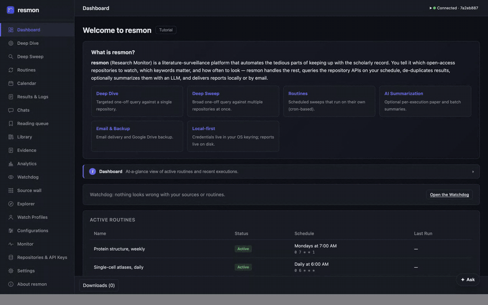

<p align="center">
  
</p>

<h1 align="center">resmon</h1>

<p align="center">
  <strong>One desktop app watching 26 open scholarly sources for the papers you follow.</strong>
</p>

<p align="center">
  <a href="https://github.com/ryanjosephkamp/resmon/actions/workflows/ci.yml"></a>
  
  
</p>

<p align="center">
  <a href="https://ryanjosephkamp.github.io/resmon/">Site</a> ·
  <a href="https://ryanjosephkamp.github.io/resmon/#tour">The 54-second tour</a> ·
  <a href="https://ryanjosephkamp.github.io/resmon/guide/">Guide</a> ·
  <a href="https://github.com/ryanjosephkamp/resmon/releases">Download</a>
</p>



resmon searches arXiv, PubMed, OpenAlex, CrossRef, bioRxiv, and 21 more open scholarly sources, on
demand or on a schedule. It de-duplicates what they return, writes chronological reading reports
into a local corpus you can search, and records what every source did on every run, so a quiet
week and a broken search never look the same.

It never claims more than it knows. A field extracted from a document, a field matched against the
corpus, and a field guessed by a model are different kinds of fact, and resmon labels which is
which. Where it cannot know something, it says so instead of showing a plausible number.

## What it does

- **Deep Dive and Deep Sweep:** one source in depth, or many in one run. Before a search runs,
  resmon says what each selected source will do with it: how it combines your keywords, whether it
  can honor your dates, whether it needs a key.
- **Routines:** the same search on a schedule, fired by an optional background service (launchd,
  a systemd user unit, or Task Scheduler). Without the service, the Routines page says nothing will
  run them.
- **Reports and a reading queue:** Markdown reports for every run, with its log and search record;
  save papers to read, and export references as BibTeX, RIS, or CSV.
- **Explorer:** search everything resmon has collected, filtered by source, category, author, and
  date.
- **Source wall and Watchdog:** what each source did on each run, and a report of sources that fail
  repeatedly, routines that are overdue, and departures from your own history.
- **Watch profiles, retraction checks, AI summaries, and Ask:** follow a person; check Crossref's
  Retraction Watch data and preprint servers for retractions and newer versions; summarize papers
  with your own provider key or a signed-in Claude Code or Codex CLI. Nothing is billed through
  resmon.
- **Delivery, backup, and an MCP server:** reports by email, to a folder, a signed webhook, or an
  Atom feed; backups to a folder or your own Google Drive; and an MCP server for tools that speak
  the Model Context Protocol.

There is no account, no resmon server, and no telemetry. The corpus is a SQLite database on your
disk, and keys are kept in your operating system's keychain.

## Install

Download a build from [Releases](https://github.com/ryanjosephkamp/resmon/releases).

| Platform | File | Status |
|---|---|---|
| macOS, Apple Silicon | DMG | Tested: installed and used daily |
| macOS, Intel | DMG | Built by the release workflow; not yet launched |
| Windows (x64) | Installer (`.exe`) | Built by the release workflow; not yet launched |
| Linux (x64) | AppImage | Built by the release workflow; not yet launched |

macOS builds are unsigned, so the first launch needs one extra step; Windows and Linux builds
update themselves. Both are covered in
[Install and launch](https://ryanjosephkamp.github.io/resmon/guide/install/), along with running
from source:

```bash
git clone https://github.com/ryanjosephkamp/resmon.git
cd resmon
python3 -m venv .venv && source .venv/bin/activate
pip install -r requirements.txt
cd resmon_scripts/frontend && npm install && npm start
```

## Documentation

The documentation lives on the project site, **<https://ryanjosephkamp.github.io/resmon/>**.

| | |
|---|---|
| [What resmon is](https://ryanjosephkamp.github.io/resmon/guide/overview/) | The feature list, and the connected-app header |
| [Install and launch](https://ryanjosephkamp.github.io/resmon/guide/install/) | Prerequisites, setup, published builds, starting the app |
| [Quick start](https://ryanjosephkamp.github.io/resmon/guide/quick-start/) | A first Deep Dive, Deep Sweep, and routine |
| [Sources and their terms](https://ryanjosephkamp.github.io/resmon/guide/sources/) | The 26 sources and what each one's terms permit |
| [Your local library](https://ryanjosephkamp.github.io/resmon/guide/library/) | Managed vaults and imported documents |
| [Projects and selected evidence](https://ryanjosephkamp.github.io/resmon/guide/projects/) | Scoping what an answer may rest on |
| [The assistant and MCP](https://ryanjosephkamp.github.io/resmon/guide/assistant/) | The in-app assistant, and the MCP server |
| [Architecture](https://ryanjosephkamp.github.io/resmon/guide/architecture/) | Backend, renderer, scheduler, stack, and source layout |
| [Configuration](https://ryanjosephkamp.github.io/resmon/guide/configuration/) | Configuration types, their JSON, export, and import |
| [HTTP API reference](https://ryanjosephkamp.github.io/resmon/guide/api-reference/) | The local API, endpoint by endpoint |
| [AI summarization](https://ryanjosephkamp.github.io/resmon/guide/ai-summarization/) | Providers, fallback chains, and per-run overrides |
| [Email notifications](https://ryanjosephkamp.github.io/resmon/guide/email-notifications/) | SMTP, credential storage, and per-routine controls |
| [Backup and restore](https://ryanjosephkamp.github.io/resmon/guide/backup/) | Local backup, and the optional Google Drive backup |
| [Contributing](https://ryanjosephkamp.github.io/resmon/guide/contributing/) | Issues, pull requests, commit messages |
| [Acknowledgments](https://ryanjosephkamp.github.io/resmon/guide/acknowledgments/) | The providers, projects, and standards this is built on |
| [License](https://ryanjosephkamp.github.io/resmon/guide/license/) | Licensing, and the third-party notices |

Reference documents (the source landscape, the backup bundle format, the local API security model,
the release procedure, and the generated HTTP and MCP contract) are rendered from
[`docs/`](docs/) at <https://ryanjosephkamp.github.io/resmon/reference/>.

Release notes are posted to <https://ryanjosephkamp.github.io/resmon/updates/> and to the Atom
feed at <https://ryanjosephkamp.github.io/resmon/feed.xml>, which the app's
**About resmon → Blog** tab reads.

## Working on resmon

```bash
.venv/bin/python -m pytest -q                      # backend, hermetic
cd resmon_scripts/frontend
npm run typecheck && npm test && npm run build     # renderer
npm run e2e                                        # the real Electron app
```

[`CONTRIBUTING.md`](CONTRIBUTING.md) covers opening a pull request: the checks to run, what its
body must carry, and how docs and tests move with a change. The project site is built from [`site/`](site/) and published out of [`docs/`](docs/);
[`site/README.md`](site/README.md) explains how.

## License

MIT, copyright Ryan Kamp. See [LICENSE](LICENSE), and the
[third-party notices](https://ryanjosephkamp.github.io/resmon/third-party-notices/) for the
components resmon ships and the sources it queries.
