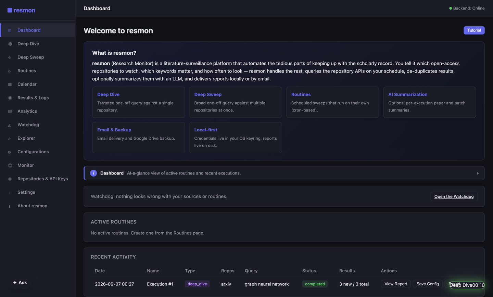

# resmon — Research Monitor

[](https://github.com/ryanjosephkamp/resmon/actions/workflows/ci.yml)

-informational)

resmon watches open-access scholarly repositories for the papers that match a researcher's
criteria, compiles them into chronological reading reports, and tells the researcher when the
watching itself has broken. It is a desktop application: the corpus, the credentials and the
reports stay on the machine that made them.

Its one rule is that it never claims more than it knows. A field extracted from a document, a
field matched against the corpus and a field guessed by a model are three different kinds of
fact, and resmon labels which is which. Where it cannot know something, it says so instead of
rendering a plausible number.



## Install

Download a build from [Releases](https://github.com/ryanjosephkamp/resmon/releases), or run from
source:

```bash
git clone https://github.com/ryanjosephkamp/resmon.git
cd resmon
python3 -m venv .venv && source .venv/bin/activate
pip install -r requirements.txt
cd resmon_scripts/frontend && npm install && npm run build && npm start
```

The full procedure, including the Windows paths and what to do with an unsigned build, is in
[Install and launch](https://ryanjosephkamp.github.io/resmon/guide/install/).

## Documentation

The long-form documentation lives on the project site at
**<https://ryanjosephkamp.github.io/resmon/>**. It used to live in this file, which had grown to
165 KB; the sections are now pages, and the mapping from the old headings to the new pages is in
the pull request that moved them and on [the guide index](https://ryanjosephkamp.github.io/resmon/guide/).

| | |
|---|---|
| [What resmon is](https://ryanjosephkamp.github.io/resmon/guide/overview/) | The feature list, and the connected-app header |
| [Install and launch](https://ryanjosephkamp.github.io/resmon/guide/install/) | Prerequisites, setup, published builds, starting the app |
| [Quick start](https://ryanjosephkamp.github.io/resmon/guide/quick-start/) | A first Deep Dive, Deep Sweep and routine |
| [Sources and their terms](https://ryanjosephkamp.github.io/resmon/guide/sources/) | The 27 shipped repositories and what each one's terms permit |
| [Your local library](https://ryanjosephkamp.github.io/resmon/guide/library/) | Managed vaults and imported documents |
| [Projects and selected evidence](https://ryanjosephkamp.github.io/resmon/guide/projects/) | Scoping what an answer may rest on |
| [The assistant and MCP](https://ryanjosephkamp.github.io/resmon/guide/assistant/) | The in-app assistant, and driving resmon from an AI harness |
| [Architecture](https://ryanjosephkamp.github.io/resmon/guide/architecture/) | Backend, renderer, scheduler, stack and source layout |
| [Configuration](https://ryanjosephkamp.github.io/resmon/guide/configuration/) | Configuration types, their JSON, export and import |
| [HTTP API reference](https://ryanjosephkamp.github.io/resmon/guide/api-reference/) | The local API, endpoint by endpoint |
| [AI summarization](https://ryanjosephkamp.github.io/resmon/guide/ai-summarization/) | Providers, fallback chains and per-execution overrides |
| [Email notifications](https://ryanjosephkamp.github.io/resmon/guide/email-notifications/) | SMTP, credential storage and per-routine controls |
| [Backup and restore](https://ryanjosephkamp.github.io/resmon/guide/backup/) | Local backup, and the optional Google Drive backup |
| [Contributing](https://ryanjosephkamp.github.io/resmon/guide/contributing/) | Issues, pull requests, commit messages |
| [Acknowledgments](https://ryanjosephkamp.github.io/resmon/guide/acknowledgments/) | The providers, projects and standards this is built on |
| [License](https://ryanjosephkamp.github.io/resmon/guide/license/) | Licensing, and the third-party notices |

Reference documents — the source landscape, the backup bundle format, the local API security
model, the release procedure and the generated HTTP and MCP contract — are rendered from
[`docs/`](docs/) at <https://ryanjosephkamp.github.io/resmon/reference/>.

## Updates

Release notes are posted to <https://ryanjosephkamp.github.io/resmon/updates/> and to the Atom
feed at <https://ryanjosephkamp.github.io/resmon/feed.xml>, which the app's
**About resmon → Blog** tab reads.

## Working on resmon

```bash
.venv/bin/python -m pytest -q                      # backend, hermetic
cd resmon_scripts/frontend
npm run typecheck && npm test && npm run build     # renderer
npm run e2e                                        # the real Electron app
```

[`AGENTS.md`](AGENTS.md) is the contract every contributor and AI harness works to: the branch
protocol, what a pull request body must carry, the traps that have cost this project time, and
the rule that outranks the rest — never overclaim. [`CONTRIBUTING.md`](CONTRIBUTING.md) is the
shorter human version.

The project site is built from [`site/`](site/) and published out of [`docs/`](docs/);
[`site/README.md`](site/README.md) explains how.

## License

See [LICENSE](LICENSE), and
[third-party notices](https://ryanjosephkamp.github.io/resmon/third-party-notices/) for the
components resmon ships and the sources it queries.
